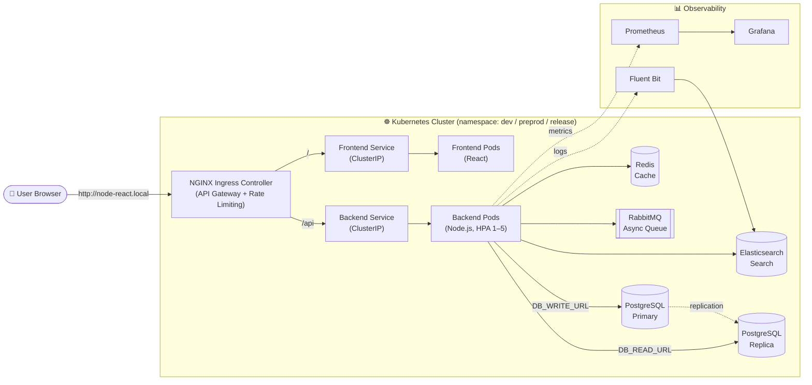
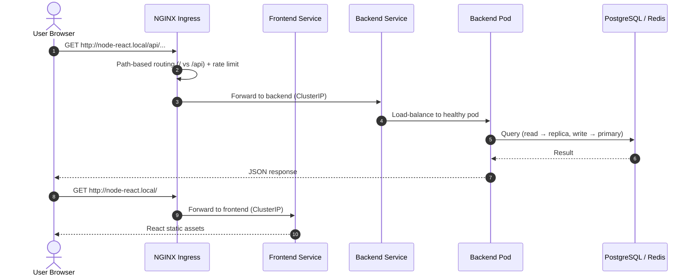
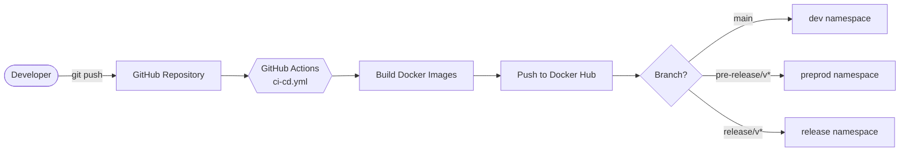
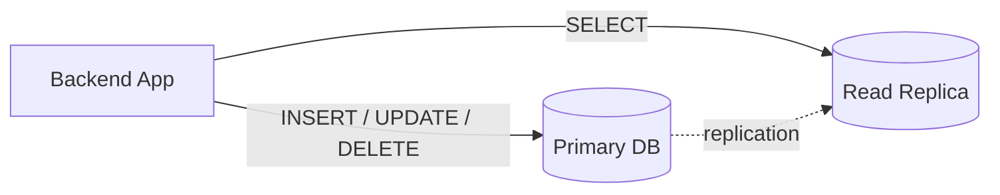
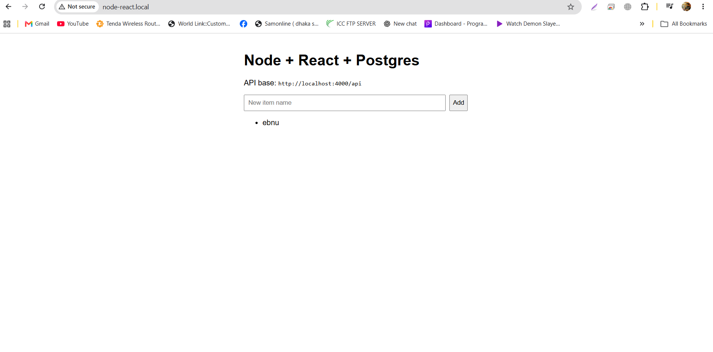
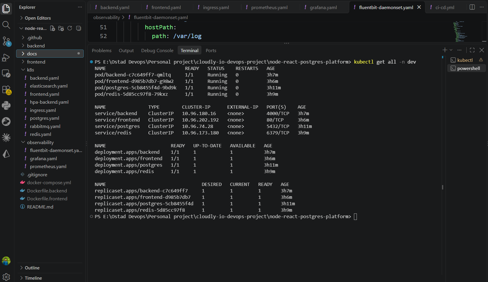

<div align="center">

# ☁️ Cloudly DevOps Platform Assessment

**A production-ready platform built around a React + Node.js + PostgreSQL application**
using Docker, Kubernetes, CI/CD, and observability tooling.


</div>

---

## 📑 Table of Contents

- [Overview](#-overview)
- [Architecture](#-architecture)
- [Tech Stack](#-tech-stack)
- [Prerequisites](#-prerequisites)
- [Task 1: Local Containerized Setup](#-task-1-local-containerized-setup)
- [Task 2 & 3: Kubernetes Deployment & Ingress](#-task-2--3-kubernetes-deployment--ingress)
- [Task 4: CI/CD & Multi-Environment Deployment](#-task-4-cicd--multi-environment-deployment)
- [Task 5: Platform Services & DB Read/Write Simulation](#-task-5-platform-services--db-readwrite-simulation)
- [Task 6: Observability, Scaling & Rate Limiting](#-task-6-observability-scaling--rate-limiting)
- [Screenshots](#-screenshots)
- [Design Decisions & Trade-offs](#-design-decisions--trade-offs)
- [Future Improvements](#-future-improvements)

---

## 🔎 Overview

This repository contains the completed hands-on assessment for the **DevOps Engineer** role. It takes a simple React + Node.js + PostgreSQL application and turns it into a production-ready platform with:

- Containerized local development (Docker Compose)
- Kubernetes deployment with NGINX Ingress
- Multi-environment CI/CD with GitHub Actions
- Platform services: Redis, RabbitMQ, Elasticsearch
- Read/write database cluster simulation
- Autoscaling, rate limiting, and observability (Prometheus, Grafana, Fluent Bit)

---

## 🏗 Architecture

### High-Level System Architecture



> 💡 You can also export this diagram as an image and save it to `docs/architecture.png` (see [Screenshots](#-screenshots)).

### Request Path



### CI/CD Flow



---

## 🧰 Tech Stack

| Layer | Technology |
|---|---|
| Frontend | React (Vite) |
| Backend | Node.js |
| Database | PostgreSQL (primary + replica simulation) |
| Cache / Queue / Search | Redis, RabbitMQ, Elasticsearch |
| Containerization | Docker, Docker Compose (multi-stage builds) |
| Orchestration | Kubernetes (`kind` / `minikube`) |
| Ingress | NGINX Ingress Controller |
| CI/CD | GitHub Actions, Docker Hub |
| Observability | Prometheus, Grafana, Fluent Bit |

---

## ✅ Prerequisites

| Tool | Purpose |
|---|---|
| **Docker & Docker Compose** | Local containerized setup |
| **Kubernetes cluster** (`kind` or `minikube`) | Local orchestration |
| **kubectl** | CLI to interact with the cluster |
| **NGINX Ingress Controller** | Installed on the local cluster |

---

## 🐳 Task 1: Local Containerized Setup

Start the entire local environment with a single command:

```bash
docker compose up -d
```

This launches the **frontend, backend, PostgreSQL, Redis, RabbitMQ, and Elasticsearch**. Multi-stage Dockerfiles (`Dockerfile.backend`, `Dockerfile.frontend`) keep the images optimized and minimal.

---

## ☸️ Task 2 & 3: Kubernetes Deployment & Ingress

### Deployment

All resources are deployed in the `dev` namespace. Apply the manifests:

```bash
kubectl apply -f k8s/
```

Then add the host entry to access the app:

```bash
echo "127.0.0.1 node-react.local" | sudo tee -a /etc/hosts
```

### Internal DNS Resolution

Kubernetes uses **CoreDNS** for internal service discovery. The backend is resolvable inside the cluster via its FQDN:

```
backend.dev.svc.cluster.local
```

### 🐞 Debugging Scenarios

<details>
<summary><b>Ingress is reachable, but backend is not</b></summary>

1. Check that backend pods are running:
   ```bash
   kubectl get pods -n dev
   ```
2. Check backend pod logs for application crashes:
   ```bash
   kubectl logs <backend-pod-name> -n dev
   ```
3. Verify the Ingress routing rules match the backend service **name** and **port**.
4. Confirm the service has endpoints (traffic is reaching pods):
   ```bash
   kubectl get endpoints backend -n dev
   ```

</details>

<details>
<summary><b>Frontend cannot talk to the backend</b></summary>

1. Verify the `VITE_API_BASE_URL` environment variable in the frontend pod.
2. Check the browser console / network tab for CORS errors or blocked requests.
3. Ensure the backend service exposes the correct port and the Ingress properly routes `/api` traffic.

</details>

### 🔮 Microservice Evolution

This Ingress-based design can evolve into a larger microservices architecture. By introducing an **API Gateway** (Kong, Ambassador) or a **service mesh** (Istio), the monolithic backend can be split into smaller services (e.g., `auth-service`, `billing-service`) and routed via dedicated Ingress paths such as `/api/auth` and `/api/billing`.

---

## 🚀 Task 4: CI/CD & Multi-Environment Deployment

A GitHub Actions pipeline (`.github/workflows/ci-cd.yml`) automates build and deployment.

### Branch-to-Environment Mapping

| Branch | Target Namespace |
|---|---|
| `main` | `dev` |
| `pre-release/v*` | `preprod` |
| `release/v*` | `release` |

### 🔐 Secrets Handling

Docker Hub credentials (`DOCKER_USERNAME`, `DOCKER_PASSWORD`) are stored as **GitHub Actions Secrets** and injected at runtime. Long-lived credentials are never committed to the repository.

### ⏪ Rollback Strategy

| Method | Command / Action |
|---|---|
| **Fast rollback** | `kubectl rollout undo deployment/backend -n <namespace>` — instantly reverts to the previous ReplicaSet |
| **CI/CD rollback** | Re-run a previous successful workflow, or revert the Git commit and push so the pipeline redeploys the last stable state |

---

## 🗄 Task 5: Platform Services & DB Read/Write Simulation

### Integrated Services

| Service | Role |
|---|---|
| **Redis** | Caching layer |
| **RabbitMQ** | Message queue for asynchronous tasks |
| **Elasticsearch** | Search engine indexing |

### Read/Write Database Cluster Simulation

The platform simulates a production DB cluster by exposing separate connection settings:

- `DB_WRITE_URL` → **Primary**
- `DB_READ_URL` → **Replica**



**Where routing logic lives:** in production, read/write routing typically sits at the **application ORM layer** (e.g., Prisma/Sequelize with read replicas) or in a **database proxy** (e.g., PgBouncer, AWS RDS Proxy) that transparently sends `SELECT` queries to replicas and writes to the primary.

**Replication lag implications:** replicas can lag behind the primary. Critical *read-after-write* flows (e.g., a user updates their profile and immediately views it) must be routed to the **primary** to avoid showing stale data.

---

## 📈 Task 6: Observability, Scaling & Rate Limiting

### Scaling & Rate Limiting

| Feature | Configuration |
|---|---|
| **Horizontal Pod Autoscaler** | Scales backend between **1 and 5 replicas** when CPU utilization exceeds **70%** |
| **Rate limiting** | NGINX Ingress annotations limit users to **20 requests/second** and **10 concurrent connections** to mitigate DDoS and API abuse |

### Observability Stack

Prometheus, Grafana, and Fluent Bit manifests live in the `observability/` folder.

### 🚨 Key Alerts

| Alert | Threshold | Why it matters |
|---|---|---|
| **High error rate** | HTTP 5xx > 5% for 5 min | Indicates backend crashes, misconfiguration, or DB connection loss |
| **High CPU / memory** | > 85% for 10 min | Abnormal load, scaling need, or memory leak |
| **High latency** | API response > 2s | Degraded UX; likely slow queries, missing indexes, or a platform-service bottleneck |

---

## 🖼 Screenshots

> Place all images in the `docs/` folder and update the file names below if needed.

### Architecture Diagram

<p align="center">
  
</p>

### Application UI

<p align="center">
  
</p>

### Kubernetes Cluster State

| Pods & Services | Ingress & HPA |
|:---:|:---:|
|  |  |

### CI/CD Pipeline

<p align="center">
  
</p>

### Observability

| Grafana Dashboard | Prometheus Targets |
|:---:|:---:|
|  |  |

---

## ⚖️ Design Decisions & Trade-offs

| Decision | Rationale |
|---|---|
| **Docker Hub over GHCR** | Simple public image access for local Kubernetes pulls, without configuring `ImagePullSecrets` |
| **Raw manifests over Helm** | Simplicity and transparency for this assessment. In a real-world setup, Helm charts would template deployments per environment |

---

## 🔭 Future Improvements

- [ ] Provision cloud infrastructure with **Terraform** (Infrastructure as Code)
- [ ] Adopt **ArgoCD** for GitOps-based continuous deployment instead of pushing directly from GitHub Actions
- [ ] Add comprehensive **readiness and liveness probes** for platform services (Redis, RabbitMQ)

---

<div align="center">

Built with ❤️ for the Cloudly DevOps Engineer assessment.

</div>
